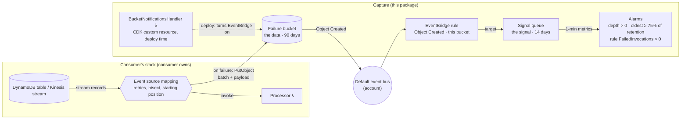
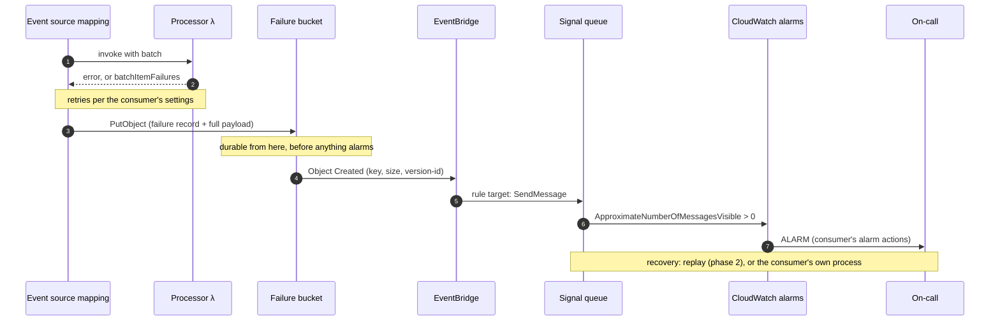
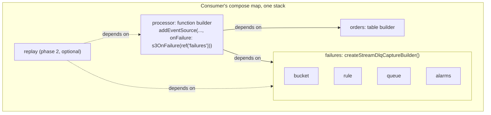

# Architecture: stream failure capture

This document describes the **capture** half of `@composure-labs/composurecdk-stream-dlq`: what it builds, how a failed stream batch becomes an alert, who owns what, and how the system behaves when its own parts fail. Recovery (the reference replay function) is phase 2 and is only outlined here.

The design comes from [laazyj/composureCDK#623](https://github.com/laazyj/composureCDK/issues/623). The behaviour described below was observed in a real AWS account during the [spike](https://github.com/laazyj/composureCDK/issues/623#issuecomment-6396650770) and [its follow-up](https://github.com/laazyj/composureCDK/issues/623#issuecomment-6397908967), unless a statement says it is untested.

## The problem

A Lambda function consuming a DynamoDB stream or a Kinesis data stream eventually exhausts its retries on some batch. Those records only exist for the stream's retention window, 24 hours for DynamoDB, so the failed batch has to be stored durably before the window closes. The on-call also has to hear about it while there is still time to act.

The obvious wirings each fail one half of that:

- **An SQS or SNS on-failure destination** keeps only the batch's metadata (shard and sequence range). Recovering means re-reading the stream before it expires.
- **An S3 on-failure destination** keeps the whole batch, but S3 has no low-latency "how many objects are waiting" metric to alarm on.

Capture uses S3 for the data and adds a separate signal that can be alarmed on.

## Overview

Capture has two responsibilities, held by two services that don't need to agree with each other:

- **S3 holds the data.** The event source mapping writes each failed batch, including the full `payload`, to the failure bucket. The bucket is the only copy.
- **SQS carries the signal.** Each object written produces one message on the signal queue, through EventBridge. The queue's depth is a 1-minute gauge that rises when a failure lands and falls only when someone deals with it, so it can be alarmed on.



The capture system never references the processor. It's a leaf of the compose graph: the processor depends on capture (to name the failure bucket as its destination), and nothing in capture depends back.

## A failure, end to end



Observed in the spike:

- the object was written 1.3–2.5 s after the record, with `retryAttempts: 0`;
- the message reached the queue 0.3–1.0 s after the object;
- the depth alarm fired within a few minutes and cleared once the queue was drained.

## What a failure object contains

The event source mapping writes one object per failed batch, keyed `aws/lambda/<ESM-UUID>/<shardId>/YYYY/MM/DD/YYYY-MM-DDTHH.MM.SS-<uuid>`. The body holds:

- `requestContext` and `responseContext`: why it failed (`RetryAttemptsExhausted`, `functionError`), and which function version ran;
- `DDBStreamBatchInfo` (or `KinesisBatchInfo`): the shard, the sequence range, arrival times and the stream ARN;
- `payload`: **the original event as a JSON string**. Re-invoking the processor with it reproduces the event exactly, which the spike confirmed.

The key holds no characters that need URL-encoding, and it embeds the write time. That matters for recovery from a lost signal (F5 below).

## Who owns what

| Concern                                                                                                  | Owner                                    | Why                                                                                                           |
| -------------------------------------------------------------------------------------------------------- | ---------------------------------------- | ------------------------------------------------------------------------------------------------------------- |
| Event source mapping settings: `retryAttempts`, `maxRecordAge`, `bisectBatchOnError`, `startingPosition` | **Consumer**                             | They know their traffic. Capture's responsibility starts when a failure occurs, not before ([D7](#decisions)) |
| Naming the failure bucket as the on-failure destination                                                  | Consumer, with `s3OnFailure(ref)`        | The helper grants only what the mapping needs ([D8](#decisions))                                              |
| Failure bucket, signal path, signal queue, alarms                                                        | **Capture**                              |                                                                                                               |
| Alarm actions (paging, tickets)                                                                          | Consumer                                 | Through composureCDK's alarm action policies; capture creates no actions                                      |
| Recovery                                                                                                 | Consumer, or the phase-2 replay function | Capture exposes the bucket, the queue and a least-privilege grant for any recovery path                       |

Two recommendations the README makes to consumers, though capture doesn't enforce them:

- **Set `startingPosition: TRIM_HORIZON` explicitly.** With `LATEST`, composureCDK's current default, records written before a new mapping's first poll are never read, so they can never fail and be captured. See [laazyj/composureCDK#635](https://github.com/laazyj/composureCDK/issues/635).
- **Bound retries.** Set `retryAttempts` and `maxRecordAge`, so a poison batch reaches capture with time to spare, rather than blocking the shard until the records expire.

## How it composes

Capture is a composed system, nestable in the consumer's own `compose` map. The consumer deploys it **in the same stack as its processor**, one capture per processor ([D10](#decisions), [D11](#decisions)).



```ts
compose(
  {
    orders: createTableV2Builder()
      .partitionKey({ name: "pk", type: AttributeType.STRING })
      .dynamoStream(StreamViewType.NEW_AND_OLD_IMAGES),

    failures: createStreamDlqCaptureBuilder(),

    processor: createFunctionBuilder()
      // ...runtime, handler, code...
      .addEventSource(
        "orders",
        dynamoEventSource(
          ref("orders", (r) => r.table),
          {
            startingPosition: StartingPosition.TRIM_HORIZON,
            retryAttempts: 3,
            onFailure: s3OnFailure(ref("failures")),
          },
        ),
      ),
  },
  { orders: [], failures: [], processor: ["orders", "failures"] },
);
```

The build result exposes everything capture creates: the failure bucket, its access-logs bucket (when enabled), the queue, the rule, the alarms, and any keys.

## Components and defaults

Every default below can be changed through the capture API ([D3](#decisions)–[D6](#decisions)).

**Failure bucket** (`createBucketBuilder()` with failure-role defaults):

| Setting            | Default                                                                       | Why                                                                                                                                               |
| ------------------ | ----------------------------------------------------------------------------- | ------------------------------------------------------------------------------------------------------------------------------------------------- |
| Encryption         | SSE-S3; a customer-managed key is opt-in                                      | With a key, the mapping's role also needs `kms:GenerateDataKey`                                                                                   |
| Versioning         | **Off**                                                                       | A deleted or expired failure should be gone, not kept as a noncurrent version                                                                     |
| Lifecycle          | Expire objects after 90 days; abort incomplete multipart uploads after 7 days | Must outlast the queue's retention: see the guard below                                                                                           |
| Removal policy     | RETAIN                                                                        | The bucket is the only copy of the data. Keeping it also stops its name being re-registered by another account, a risk the Lambda docs warn about |
| Access logs        | On, to a dedicated logs bucket; can be disabled                               | Audit trail for who read or deleted failures                                                                                                      |
| Public access, TLS | Blocked; TLS enforced                                                         | composureCDK's bucket defaults                                                                                                                    |
| EventBridge        | On, through CDK's `eventBridgeEnabled`                                        | See the signal path below                                                                                                                         |

**Signal path:** the bucket sends every event to the account's **default event bus**, and a rule matching `aws.s3` / `Object Created` / this bucket's name targets the queue. The target uses EventBridge's default retry policy (24 hours, up to 185 attempts) and **no dead-letter queue** ([D2](#decisions)).

EventBridge was chosen over a direct S3 → SQS notification ([D1](#decisions)) for three reasons:

- **No test events.** A direct notification sends an `s3:TestEvent` whenever it is created or changed. In the spike each one tripped the depth alarm, and SQS can't filter messages on arrival.
- **No clash with the consumer's own notifications.** A bucket has one notification configuration, and S3 rejects overlapping filters. EventBridge leaves that configuration free.
- **The key arrives decoded.**

**`BucketNotificationsHandler`:** CDK switches EventBridge on through a per-stack custom-resource Lambda ([D12](#decisions)). It runs at deploy time only. It's kept because it's idiomatic and because it merges every notification declared in CDK into one configuration. The follow-up spike showed:

- with the handler, a consumer's own `addEventNotification` on the failure bucket **coexisted** with EventBridge;
- with EventBridge set on the low-level bucket resource instead, the same notification **silently switched EventBridge off**.

**Signal queue** (`createQueueBuilder("dlq")`):

| Setting            | Default                                                                  | Why                                                                      |
| ------------------ | ------------------------------------------------------------------------ | ------------------------------------------------------------------------ |
| Encryption         | SSE-SQS; a customer-managed key is opt-in                                | A queue key must allow `events.amazonaws.com` (untested; see open items) |
| Retention          | 14 days, the SQS maximum                                                 | The longest the signal can wait                                          |
| Visibility timeout | 1 minute                                                                 | A crashed or failed consumer releases messages promptly                  |
| Depth alarm        | Visible messages > 0, one 1-minute datapoint, missing data not breaching | Any message is a failure that needs attention                            |
| Age alarm          | Oldest message ≥ 75% of retention (10.5 days)                            | The last warning before SQS deletes the signal                           |

**Rule alarm:** `FailedInvocations > 0` on the rule ([D2](#decisions)) is the detection for a lost signal (F5).

**Lifetime guard:** S3 holds the data and SQS the signal, so their lifetimes only need one relationship: **the object must outlive its signal.** Capture fails at synth if the bucket's expiry isn't longer than the queue's retention ([D5](#decisions)). Beyond that the two are independent:

- when a signal expires, the object stays until the lifecycle removes it;
- a stale object is never re-signalled.

## Failure modes and effects

The system has several moving parts, so this section follows the shape of a **Failure Mode and Effects Analysis** (IEC 60812).

- **Each row:** one way a part can fail; its effect on the **data** (the failed records) and the **signal** (the alert); how it's detected; and what mitigates it or recovers from it.
- **Severity (S):** **H** means data loss or a silent loss of signal; **M** means a delayed or degraded signal; **L** means noise.
- **Occurrence (O):** how likely the failure is, given the defaults.
- **Detection (D):** **H** means nothing detects it, **M** means a log or manual check would show it, **L** means an alarm fires.
- **Verified:** whether the spike reproduced the failure in a real account.

| ID  | Part                                | Failure mode                                                                                            | Effect on data                                                | Effect on signal                                                                       | S   | O   | D           | Detection                                                                                                                     | Mitigation and recovery                                                                                                                                                                  | Verified                                                                    |
| --- | ----------------------------------- | ------------------------------------------------------------------------------------------------------- | ------------------------------------------------------------- | -------------------------------------------------------------------------------------- | --- | --- | ----------- | ----------------------------------------------------------------------------------------------------------------------------- | ---------------------------------------------------------------------------------------------------------------------------------------------------------------------------------------- | --------------------------------------------------------------------------- |
| F1  | Event source mapping → bucket       | Write fails: missing permission, key denied, bucket gone                                                | **Batch discarded**                                           | None raised                                                                            | H   | L   | M           | The processor's dropped-events alarm (composureCDK's stream alarms). Its behaviour for a failed destination write is untested | `s3OnFailure` grants exactly what the mapping needs; the bucket is RETAINed                                                                                                              | No                                                                          |
| F2  | Bucket                              | Deleted while still the destination; name re-registered elsewhere                                       | Failures written to **another account's bucket**              | Signal lost                                                                            | H   | L   | H           | None                                                                                                                          | RETAIN by default; the grant is scoped to this bucket's ARN                                                                                                                              | No (AWS-documented risk)                                                    |
| F3  | Bucket's notification configuration | EventBridge switched off out of band (console, CLI or SDK replacing the configuration)                  | Safe                                                          | **None for every later failure**                                                       | H   | L   | H           | None: no `MatchedEvents`, no `FailedInvocations`                                                                              | CDK owns the configuration and restores it at the next deploy that rewrites it. Don't edit the failure bucket's notifications outside CDK. Drift detection                               | Partly: the spike produced the same effect through a CDK misconfiguration   |
| F4  | Rule                                | Disabled or deleted out of band                                                                         | Safe                                                          | None                                                                                   | H   | L   | H           | CloudFormation drift detection                                                                                                | Redeploy                                                                                                                                                                                 | No                                                                          |
| F5  | Rule → queue                        | Delivery denied (queue policy or key policy drift) or exhausted after retries                           | Safe                                                          | **Lost for that failure**                                                              | M   | L   | L           | `FailedInvocations` alarm fired about 1.5 min after the object was written (with retries off)                                 | List the bucket by `LastModified` across the alarm's window (as wide as the retry window, up to 24 h) and recover those objects. Replaying an object that was also signalled is harmless | Yes                                                                         |
| F6  | Queue                               | Signal not acted on                                                                                     | Safe until the lifecycle expiry                               | Age alarm at 75% of retention; at 14 days SQS deletes the message and the alarms clear | M   | M   | L           | Age alarm                                                                                                                     | The object remains until its 90-day expiry, by design. Act on the age alarm                                                                                                              | Yes (on a 5-minute retention)                                               |
| F7  | Configuration                       | Bucket expiry not longer than queue retention                                                           | Object deleted while its signal is still live                 | A signal for data that's gone                                                          | M   | L   | L           | Synth fails                                                                                                                   | The lifetime guard                                                                                                                                                                       | n/a                                                                         |
| F8  | Alarms                              | No actions configured                                                                                   | Safe                                                          | Raised to nobody                                                                       | H   | M   | H           | None                                                                                                                          | The README requires alarm actions; composureCDK alarm action policies                                                                                                                    | n/a                                                                         |
| F9  | EventBridge                         | Duplicate delivery (at-least-once)                                                                      | Safe                                                          | Depth over-counts                                                                      | L   | L   | L           | n/a                                                                                                                           | Recovery treats a missing object as already handled                                                                                                                                      | No                                                                          |
| F10 | Event source mapping                | Records written before a new mapping's first poll, or during its replacement, are never read (`LATEST`) | **Never captured**: not a failure, so nothing reaches capture | None                                                                                   | H   | M   | H           | None                                                                                                                          | Outside capture's boundary. The README recommends `TRIM_HORIZON` ([#635](https://github.com/laazyj/composureCDK/issues/635))                                                             | Yes                                                                         |
| F11 | Event source mapping                | Unbounded retries or no on-failure destination                                                          | Records expire on the stream                                  | None                                                                                   | H   | M   | M           | composureCDK's stream DLQ synth warning; iterator-age alarm                                                                   | The consumer bounds retries and sets `s3OnFailure`                                                                                                                                       | No                                                                          |
| F12 | Stack                               | Stack deleted with failures outstanding                                                                 | Bucket retained                                               | Queue, rule and alarms deleted                                                         | M   | L   | H           | None                                                                                                                          | Documented teardown: drain or export first                                                                                                                                               | No                                                                          |
| F13 | Notifications handler               | Fails at deploy                                                                                         | Safe                                                          | n/a                                                                                    | L   | L   | L           | Deploy fails and rolls back                                                                                                   | Fix and redeploy                                                                                                                                                                         | Yes (a misconfigured queue key failed the deploy)                           |
| F14 | Queue key (opt-in)                  | Key policy drift after deploy                                                                           | Safe                                                          | Lost for each failure                                                                  | M   | L   | L, expected | Expected to surface as F5                                                                                                     | As F5                                                                                                                                                                                    | No: drift was tested on the direct S3 → SQS path, where it dropped silently |

## Decisions

| ID  | Decision                                                                                                                        | Rationale                                                                                                                                                                                                                                                 | Source                                            |
| --- | ------------------------------------------------------------------------------------------------------------------------------- | --------------------------------------------------------------------------------------------------------------------------------------------------------------------------------------------------------------------------------------------------------- | ------------------------------------------------- |
| D1  | EventBridge carries the signal                                                                                                  | No test events; no clash with the consumer's own notifications; decoded keys                                                                                                                                                                              | Spike §1–2; the signal-path comparison            |
| D2  | No dead-letter queue on the rule; a `FailedInvocations` alarm instead                                                           | A DLQ for the DLQ adds a part that can fail. The alarm bounds a time window, and the bucket is the source of truth for what failed. EventBridge's bus logs do record the object key, but they are best-effort and set on the account's shared default bus | Spike follow-up §2                                |
| D3  | SSE by default; customer-managed keys opt-in for the bucket and the queue                                                       | SSE has no key policy to drift (F14)                                                                                                                                                                                                                      | Spike §3                                          |
| D4  | Lifecycle and retention defaults as above, all configurable; versioning off; access logs on, can be disabled                    |                                                                                                                                                                                                                                                           | Plan §2; maintainer decision                      |
| D5  | Synth-time guard: bucket expiry > queue retention                                                                               | The one relationship the two lifetimes must keep                                                                                                                                                                                                          | Maintainer decision                               |
| D6  | Queue defaults from the `dlq` role, configurable                                                                                |                                                                                                                                                                                                                                                           | Issue #623                                        |
| D7  | Capture doesn't configure the event source mapping                                                                              | Capture's responsibility starts when a failure occurs; the consumer knows their traffic                                                                                                                                                                   | Maintainer decision                               |
| D8  | `s3OnFailure(ref)` grants only `s3:PutObject` and `s3:ListBucket` on the failure bucket (plus `kms:GenerateDataKey` with a key) | CDK's `S3OnFailureDestination` grants read and write, so the processor could read and delete every captured failure                                                                                                                                       | Lambda docs                                       |
| D9  | One capture per processor                                                                                                       | Clear ownership; alarms map to one consumer                                                                                                                                                                                                               | Maintainer decision                               |
| D10 | Capture deploys alongside the processor, never in a separate persistence stack                                                  | The failure bucket holds transient runtime state (until resolved, replayed or discarded), not long-term storage. Splitting the failure path across stacks adds ways for it to break                                                                       | Maintainer decision; supersedes #623's "pillar 5" |
| D11 | DynamoDB Streams first; Kinesis supported by the same design                                                                    | The S3 on-failure destination and object format are shared; Kinesis waits on laazyj/composureCDK#120                                                                                                                                                      | Issue #623                                        |
| D12 | Switch EventBridge on through CDK's `BucketNotificationsHandler`                                                                | Idiomatic, and it keeps the consumer's own CDK notifications on the bucket safe                                                                                                                                                                           | Spike follow-up                                   |
| D13 | aws-cdk-lib peer floor `^2.184.0`                                                                                               | The release that added S3 on-failure destinations for DynamoDB and Kinesis. Proven by deploying on it                                                                                                                                                     | Spike §6                                          |

## Testing

- **Unit and synth tests** in CI: construct paths, defaults, the lifetime guard and the grant.
- **A functional test before every release**, like composureCDK's sandbox deploy. It deploys a capture stack to the sandbox account, waits for the event source mapping to be `Enabled`, forces one failure, and checks that the object lands, the signal arrives, and the depth alarm fires and then clears. Then it tears everything down.
  - Teardown uses a copy of composureCDK's `cleanDeskPolicy`. Any extension it needs is raised as a PR on both copies.
  - The spike showed the test must poll: queue counts lag by 30 s or more, and a new mapping takes minutes to start reading.

## Open items

- A customer-managed key on the queue with the EventBridge path: the key policy for `events.amazonaws.com`, and whether drift surfaces as `FailedInvocations` (F14).
- Whether a failed destination write (F1) shows up in the processor's dropped-events alarm.
- Whether EventBridge retries a permission error under the default retry policy (F5's recovery window).
- Kinesis, once laazyj/composureCDK#120 lands.
- Phase 2: the reference replay function, prototyped in the spike (`drain()`, with B1 and B2 from the plan).
